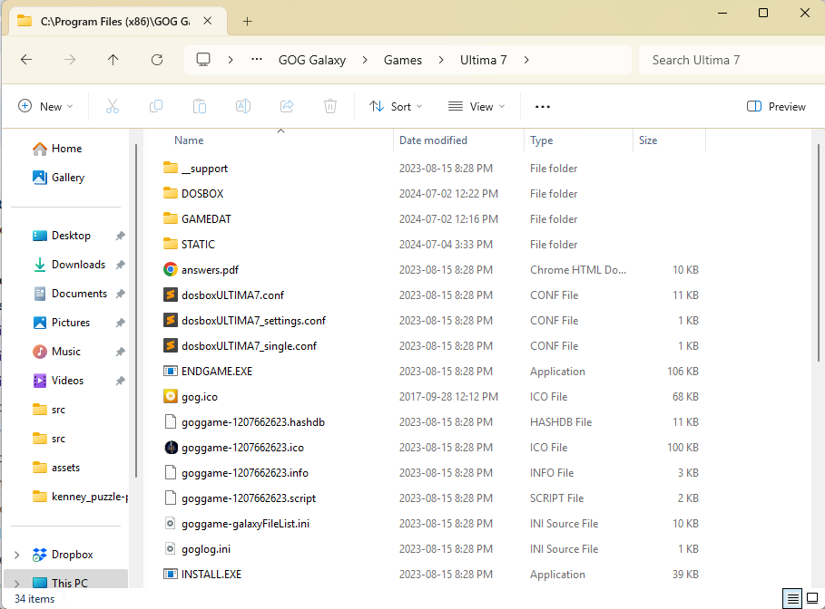
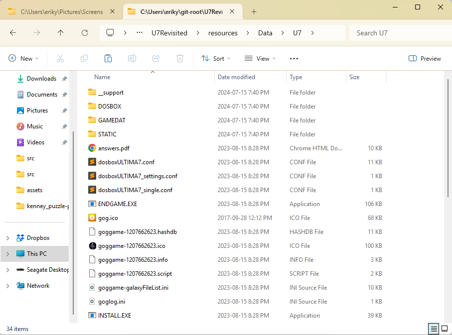

# Ultima VII: Revisited

Welcome to Ultima VII: Revisited, my attempt to write a replacement engine for Ultima VII: The Black Gate.

If you like this project, please consider supporting me!

https://ko-fi.com/viridiangames

https://www.patreon.com/c/viridiangames

<a href="https://www.youtube.com/watch?v=iDK5f3IkmrQ">
  
</a>
(Click for a preview of coming attractions.)

## Installation and Running the Engine

To run this program, you will need to copy the contents of your original DOS ULTIMA7 folder to `/Data/u7`.  This
will allow the replacement engine to read in the maps and graphics from the original files.

- Locate your Ultima 7 game files (eg. `C:\Program Files (x86)\GOG Galaxy\Games\Ultima 7`)


- Copy ALL of these files, folders and subfolders into `./Data/U7` (*hint: look for the `U7.txt` file*)



## Developer Installation Notes

- Clone the project into a local folder using whatever git interface you prefer
- Copy the entire contents of your original DOS ULTIMA7 directory to `$(SolutionDir)/Redist/Data/U7/`

### Building with Meson (Cross-platform)

- Make sure you have the [Meson Build system](https://mesonbuild.com/) installed
- Run `meson setup build`, or if you want to generate a Visual Studio project, `meson setup --backend vs build`
- Run `meson compile -C build` to build the project
- Run the game from `Redist` so it can find its assets: `cd Redist && ../build/U7Revisited`

### Building on macOS

Use CMake to build both the game and the Ghost GUI editor on macOS.

**Required tools:**

- **Xcode Command Line Tools:** Apple Clang with C++17 support, Make, Git, and the macOS SDK. A full Xcode installation also provides these tools.
- **[CMake 3.15 or newer](https://cmake.org/download/):** Configures and builds the project, downloads raylib, and includes CTest for running the contract tests.

Meson, Ninja, and Python are not required for this workflow.

Install the Command Line Tools if they are not already installed, and finish the installer before continuing:

```bash
xcode-select --install
```

Install CMake from its website and make sure `cmake` and `ctest` are on your `PATH`. If you install the official CMake app in `/Applications`, you can add its tools to the current shell with:

```bash
export PATH="/Applications/CMake.app/Contents/bin:$PATH"
```

Alternatively, if you already use [Homebrew](https://brew.sh/), install CMake with:

```bash
brew install cmake
```

**Libraries provided by the project or macOS:**

- **raylib 5.0:** CMake downloads a checksum-verified source archive from GitHub and builds it for your Mac. Its GLFW window backend and audio/image dependencies are bundled with raylib.
- **Lua 5.4.7:** Built from the sources in `ThirdParty/lua`.
- **nlohmann/json:** Headers are included in `ThirdParty/nlohmann`.
- **Cocoa, IOKit, CoreVideo, CoreFoundation, and OpenGL:** System frameworks supplied by macOS and its SDK.

The first CMake configure requires internet access to download raylib.

**Build and run:**

Copy the contents of your original DOS Ultima VII: The Black Gate installation into `Redist/Data/U7/`. These game files are required to run the game; Ghost uses the editor assets already in `Redist`.

From the repository root, configure with the Makefiles generator and build:

```bash
cmake -S . -B build-cmake -G "Unix Makefiles" -DCMAKE_BUILD_TYPE=Release
cmake --build build-cmake --parallel 4
```

The Makefiles generator uses the Make supplied by Apple's Command Line Tools. Keep `build-cmake` separate from any existing Meson build directory. Run the contract tests with:

```bash
(cd build-cmake && ctest --output-on-failure)
```

Mac executables stay in `build-cmake`. Launch either application from `Redist` so its relative asset paths resolve correctly:

```bash
# Game
(cd Redist && ../build-cmake/U7Revisited)

# Ghost GUI editor
(cd Redist && ../build-cmake/Ghost)
```

### Building with CMake (Windows & Linux)

**Windows:**
1. Install CMake (3.15 or higher) - Visual Studio 2019+ includes CMake support that you can install via the Visual Studio Installer. See [CMake projects in Visual Studio](https://learn.microsoft.com/en-us/cpp/build/cmake-projects-in-visual-studio?view=msvc-170) for details.
2. You MUST open "Developer Command Prompt for VS 2019" to get a console with cmake on your path! A normal Powershell or cmd.exe will not work!
3. CD to the project folder, and configure and generate build files:
    ```bash
      cd U7Revisted
      cmake -S . -B build
    ```
4. Open the new solution file in Visual Studio 2019+: `build/U7Revisited.sln`
5. Build the project using Visual Studio (Ctrl+Shift+B or Build → Build Solution) or F5 to build & debug
6. The Release executable will be automatically copied to `Redist/u7revisited.exe` after building

**Linux:**
1. Install CMake and required dependencies:
   ```bash
   sudo apt-get install cmake build-essential libgl1-mesa-dev libx11-dev libxrandr-dev libxi-dev libxcursor-dev libxinerama-dev
   ```
2. Configure and generate build files: `cmake -S . -B build -DCMAKE_BUILD_TYPE=Release`
3. Build the project: `cmake --build build -j$(nproc)`
4. The Release executable will be automatically copied to `Redist/u7revisited` after building

## Controls:

- `WASD`:  Move around.
- `Q/E`:  Rotate left and right.
- `Mousewheel`:  Zoom in/Zoom out.
- To teleport to a location, left-click there in the minimap.
- Double-left-click on an NPC to attempt to talk to them (not all NPCs work yet)
- Double-right-click on a container to open it and view its contents (NPCs are considered containers)
- Press +/- on the keypad to slow down/speed up time.  Press Enter on the keypad to advance time one hour.
- Press `ESC` to exit.

This is an open source project, which means that you can grab the source files from github.com/viridiangames and
build it yourself!

## Sandbox Mode

Sandbox is the "debug" mode and has extra options available for building and testing the world. You can make changes and save them to work on the game from inside the game!  The red square in the upper left corner toggles NPC pathfinding.

- LMB - Clicking on objects, NPCs or floor tiles prints debug info
- LDBL - Left double clicking calls Interact() on objects/NPCs
- F1 Toggles the Shape Editor Tool
- F7 Toggles black outline borders and dragging of static objects
- F8 Toggles Lua debug for extra logging
- F9 Toggles debug bounding boxes
- F10 Toggles pathfind costs shown by coloring tiles
- F11 Toggles green highlights for scripted objects
- -> Right arrow skips ahead time to the next hour

**FEEDBACK IS WELCOME BOY HOWDY IS IT WELCOME!**

The best way to give feedback is to send it to my email address anthony.salter@gmail.com and put `Revisited` in
the subject line.

Have fun, and Rule Britannia.
